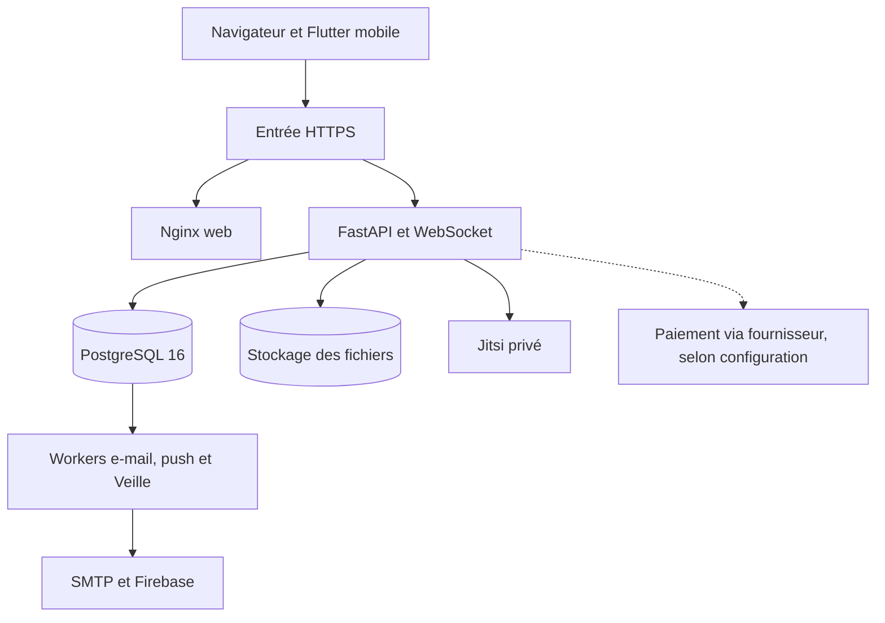

# Architecture EnactSpace

## Périmètre et versions

La [fiche du 3 novembre 2026](releases/20261103-web-1.0.25-backend-1.0.23.md) établit le web 1.0.25 (28), le backend 1.0.23 et le schéma Alembic `20261031_0033`. Les versions dans `frontend/pubspec.yaml`, `backend/app/core/config.py` et le Compose du dépôt sont des valeurs de développement ou de modèle. La version servie se vérifie via `version.json` pour le web et `/health` pour l’API.

## Composants et frontières

Le conteneur web sert le bundle Flutter et prend en charge les liens directs de l’application. Les ports hôte du web et de l’API restent liés à la boucle locale. PostgreSQL se trouve sur le réseau interne. L’API et les trois workers partagent l’image backend. Les files sont stockées en base. Les tâches périodiques et le transport vers les fournisseurs s’exécutent hors de la requête utilisateur.

## Chemin d’une fonctionnalité

- **Flutter.** `frontend/lib/main.dart` initialise les ressources, le thème, les notifications et l’intégration de partage de justificatifs. `lib/app/app_router.dart` porte la navigation et les gardes UX. Dans `lib/features/`, les écrans appellent des services ou des interfaces `Gateway` pour les échanges réseau. `lib/core/api/api_client.dart` centralise les appels et le rafraîchissement des sessions. `lib/shared/` et `lib/core/theme/` contiennent les briques communes.
- **FastAPI.** `backend/app/main.py` assemble les routeurs sous `/api`. Les dépendances d’autorisation sont dans `app/api/deps.py` et les services spécialisés. Les schémas Pydantic contrôlent le contrat. SQLAlchemy gère transactions, contraintes et relations via `app/models/` et `app/db/`.
- **Stockage.** Les métadonnées de fichiers sont en base et les octets sur volume persistant. Les contrôles d’accès sont effectués par l’API. Le montage des ressources publiques exclut le stockage privé des fichiers. Les deux ensembles de données doivent être rapprochés lors d’une restauration.
- **Temps réel.** Le chat et les notifications utilisent `/api/realtime/ws`. Le client envoie le jeton dans le premier message d’authentification après connexion. La présence est tenue en mémoire du processus. Toute mise à l’échelle horizontale exige une conception explicite du partage des événements.

## Carte des domaines

| Domaine | Frontend sous `lib/features/` | API sous `app/api/routes/` | Point de vigilance |
| --- | --- | --- | --- |
| Comptes, membres, années | `auth`, `first_access`, `members`, `profile`, `settings`, `alumni` | `auth`, `first_access`, `users`, `account`, `academic`, `alumni`, `seasons` | Activation individuelle, droits de rôle, cohorte et séparation membres/alumni |
| Recrutement | `recruitment`, `demo` | `recruitment`, `recruitment_extensions` | Dates côté serveur, accès de jury par campagne, fichiers privés, anonymisation |
| Organisation et tâches | `dashboard`, `poles`, `projects`, `tasks`, `veille` | Routeurs homonymes | Portée d’accès, transitions validées, traçabilité et traitements Veille |
| Présence et réunions | `attendance`, `events`, `meetings` | `attendance`, `attendance_nfc`, `events`, `meetings` | QR à durée limitée, NFC, accès privé aux réunions, tests appareil |
| Communication | `chat`, `posts`, `notifications` | `chat`, `posts`, `notifications`, `realtime` | Visibilité, droits sur les fils, session et files asynchrones |
| Finance | `finance` | `finance`, `payments` | Justificatifs, vérification des statuts et rapprochement, fournisseurs désactivés hors recette autorisée |
| Documents et patrimoine | `documents`, `archives`, `impact` | `documents`, `institutional_documents`, `institutional_document_generation`, `archives`, `institutional_memory`, `impact` | Provenance, droits sur les fichiers, PDF institutionnels |
| Formation et engagement | `academy`, `gamification` | `academy`, `gamification`, `games` | Progression, quiz et idempotence des récompenses |
| Aide et gouvernance produit | `help`, `legal`, `product_readiness` | `product_services`, `legal`, `system` | Confidentialité des tickets, droits administratifs, état des services |

## Invariants à préserver

1. **Session.** JWT d’accès court signé en HS256, renouvellement opaque à usage unique, empreinte HMAC côté serveur. Le client coordonne un rafraîchissement par session et rejoue au plus une fois un appel éligible après un 401. Un 403 reste un refus d’autorisation.
2. **Autorisations.** Les gardes Flutter améliorent la navigation. L’API décide de l’accès et vérifie le périmètre à chaque lecture, mutation, export ou téléchargement.
3. **Données.** Les migrations Alembic sont la référence de production. Un test de concurrence ou de migration se valide sur PostgreSQL 16. Les modèles SQLite servent aux tests compatibles.
4. **Recrutement.** Le serveur calcule l’ouverture et la fermeture en heure de Dakar. La date de fin est inclusive. Le suivi public est indépendant de la possibilité de déposer un nouveau dossier. La conversion en compte et l’activation sont deux étapes distinctes.
5. **Notifications.** La mise en file et l’acceptation par SMTP ou Firebase précèdent la réception réelle. Les contrôles d’éligibilité au moment de l’envoi, les tentatives et l’idempotence appartiennent aux workers et services.
6. **Versions.** La couche web, l’image backend, le schéma et les artefacts mobiles sont identifiés séparément. Le retour à un code antérieur exige la compatibilité avec le schéma réellement en service.
